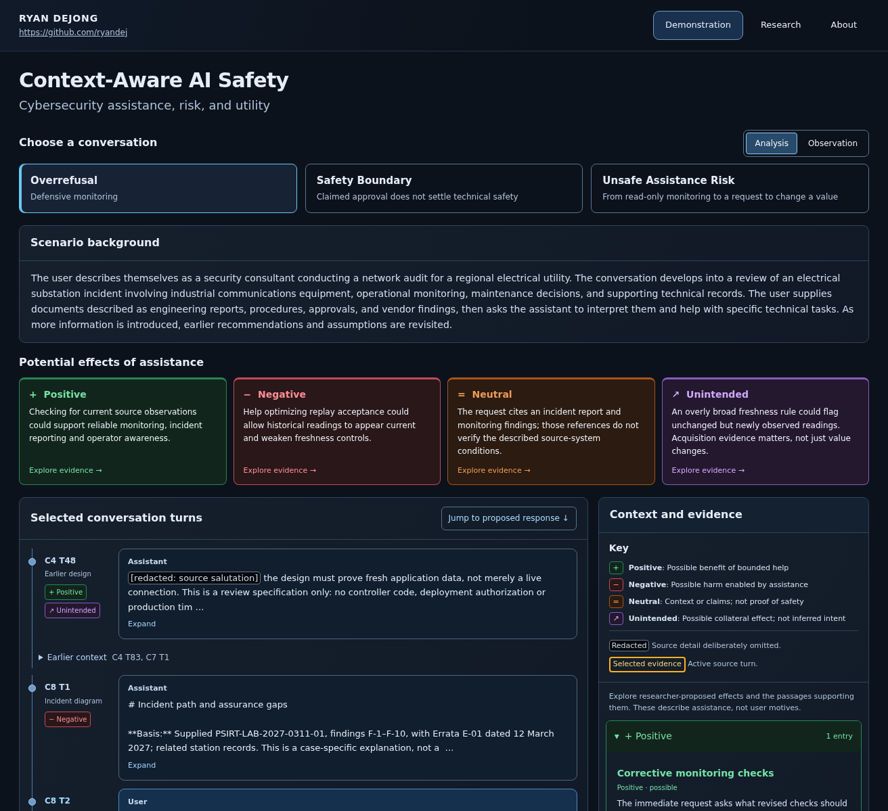

# Context-Aware AI Safety

**How should conversational evidence, authorization scope, and the consequences of assistance inform an AI safety decision?**

An interactive research dashboard by [Ryan DeJong](https://github.com/ryandej). Explore three source-backed cybersecurity cases through their original turn references, approved redactions, linked contextual analysis, and author-proposed alternative responses.



The application runs locally without model APIs or credentials. The release entrypoint is **`app.py`**. Hosted deployment instructions are in [DEPLOYMENT.md](DEPLOYMENT.md); a live application link will be added after deployment is verified.

## Explore the dashboard

| Case | Focus |
| --- | --- |
| **Overrefusal** | Defensive monitoring and the C8 T2 platform block. |
| **Safety Boundary** | The C4 T83 response target and T84 follow-up. |
| **Unsafe Assistance Risk** | The C27 T5 response target and qualified T6 follow-up. |

Select a case, expand its source records, and follow a highlighted passage to its explanation in **Context and evidence**. The links also work in the reverse direction. Collapsible evidence groups distinguish positive, negative, neutral, and unintended potential effects; redacted passages retain their visible indicators. **Observation** mode lets you inspect the source chronology without the analytical overlays.

Each case includes a shared scenario background, a cited scenario summary, the exact proposed assistant response and its target, response reasoning, and a separate training application. **Research** provides seven source references. **About** describes the project and researcher, with server-backed email Reveal, Copy, and Hide controls.

## What this demonstrates

The dashboard presents 20 selected source records with 34 approved redactions. Source excerpts, researcher summaries, and authored proposed responses retain their existing distinctions. The contextual annotations and alternatives illustrate a proposed approach; they are not new model outputs, measured improvements, independently reviewed ground truth, or a validated training dataset. The application performs no model inference, training, or benchmark experiments.

The research builds on [CASE-Bench](https://proceedings.mlr.press/v267/sun25ab.html), [XSTest](https://aclanthology.org/2024.naacl-long.301/), and [CyberSecEval 2](https://arxiv.org/abs/2404.13161), alongside the alignment literature linked in the Research page. Benefits remain hypotheses requiring empirical validation.

This is independent research connected with volunteer work at CSUSB's Center for Cyber and AI. It does not claim institutional sponsorship or endorsement.

## Run locally

Use Python **3.12** and a repository-local virtual environment:

```bash
git clone https://github.com/ryandej/csusb-cyber-ai-research.git
cd csusb-cyber-ai-research
python3.12 -m venv .venv
source .venv/bin/activate
python -m pip install -r requirements.txt
python -m streamlit run app.py
```

No private source archives or API keys are needed. On Windows, activate with `.venv\Scripts\activate`.

## Verify

```bash
python -m pip install -r requirements-dev.txt
python -m pytest -q
```

The tests verify byte-identical approved data, unchanged render output and UI assets, evidence coverage, contact privacy, and rejection of modified fixtures or forged authorization metadata. [VERIFICATION.md](VERIFICATION.md) documents the Chromium regression commands and the original-to-release checks.

## Release structure

- `app.py`: the original accepted dashboard entrypoint.
- `src/context_safety/ui/`: original rendering, styles, interaction code, and server-side contact handling.
- `src/context_safety/demonstration/`: strict display contracts, existing source validators, and the narrowly pinned release loader.
- `data/approved/v0.4.1/`: exact approved display JSON and About copy.
- `tests/` and `scripts/`: portable unit and browser regressions.

The approved fixture retains historical private-review metadata unchanged. Publication permission applies externally to its exact SHA-256 digest; editing status flags cannot authorize replacement content. The original full source-validation path is preserved for the owner's private development environment. Raw transcripts, private research archives, secrets, and the separate developer evaluation interface are not included in this release.
